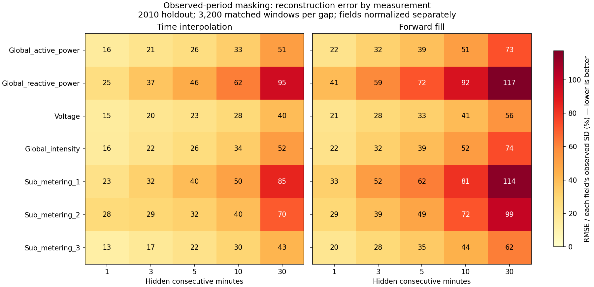
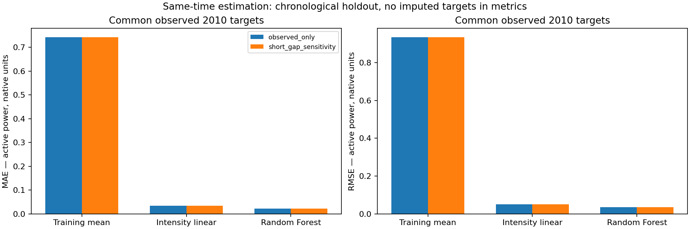
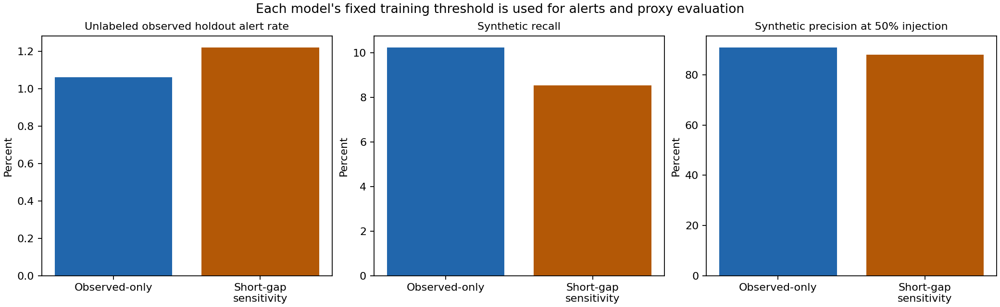

# Household Energy Data Quality and Same-Time Estimation

**Start here: [revised, executed analysis notebook](revised_analysis_observed_baseline.ipynb).**
[final.ipynb](final.ipynb) is the **preserved original**, retained unchanged.
This project uses free local tools to audit minute-resolution household readings,
reconcile SQL results, evaluate missing-data treatment, and compare models.

## Findings at a glance

- **Audit:** 2,075,259 source rows; 25,979 rows (1.2518%) lack all seven
  measurements across 71 runs. No duplicate rows/timestamps or absent minute
  timestamps were found. Other implemented validity checks also found no failures.
- **Missing data:** observed-only records remain primary (2,049,280 retained).
  Optional retrospective sensitivity fills 76 records / 532 cells in 55 complete,
  bounded runs of at most five minutes. It leaves 25,903 records excluded.
  Longer runs are never partially filled; leading/trailing gaps stay missing.
  The provisional cap **has not met field-specific acceptance tolerances**.
- **Same-time estimation:** on 457,394 observed later-period targets, primary
  Random Forest MAE is **0.021528**, RMSE **0.036277**, and R² **0.998488**.
  Intensity-only linear and training-mean baseline MAEs are 0.034893 and 0.742154.
  These errors use active power's native units. Closely related simultaneous
  readings explain the strong fit; this is **not future forecasting**.
- **Anomaly proxy:** the primary Isolation Forest recovered only **1,024 of
  10,000 injections (10.24% recall)**. Its 90.94% proxy precision assumes
  original records are negative and uses artificial 50% injection prevalence.
  The 4,854 real-data alerts are **unlabeled**, not confirmed faults or theft.

Training precedes January 1, 2010; testing uses available 2010 data through
November 26. Learned preprocessing is fitted on training data only. Each
Isolation Forest's frozen training threshold is used unchanged for real alerts
and synthetic evaluation. No separately tuned evaluation model is used.

| Scenario | RF MAE | Synthetic recall | Proxy precision | Unlabeled alerts |
| --- | ---: | ---: | ---: | ---: |
| Observed-only primary | 0.021528 | 10.24% | 90.94% | 4,854 |
| Short-gap sensitivity | 0.021543 | 8.55% | 88.05% | 5,579 |

Both regression variants use the same observed test targets. Sensitivity scores
10 additional imputed records for alerts; none triggered an alert. Adding 66
imputed training records also changes tree sampling, so changes cannot be
attributed solely to imputation quality. The sensitivity does not validate the
policy. See [full findings](reports/revised_analysis/findings.md) and
[retention counts](reports/revised_analysis/retention_counts.csv).

## Three key charts



Each cell is RMSE divided by that field's observed standard deviation; lower is
better. Measurements are normalized separately, never pooled into a raw error
score. Interpolation uses a future endpoint and is retrospective. Masking observed
periods cannot establish real missing-period behavior. [Full masking results](docs/missing_data_evaluation.md).



Earlier-period training, later-period observed targets, and explicit simple
baselines. [Regression metrics](reports/revised_analysis/regression_metrics.csv)
and [monthly results](reports/revised_analysis/regression_metrics_by_month.csv).



Synthetic stress patterns are not validated fault mechanisms. Real alert
precision is unknown. Single-household coverage, serial dependence, partial-year
holdout coverage, and unvalidated interpolation tolerances remain limitations.
[Isolation metrics](reports/revised_analysis/isolation_forest_metrics.csv).

## Audit, SQL, and reviewable evidence

[Audit summary](reports/audit_summary.md), [SQLite queries](sql), and
[MySQL queries](mysql) distinguish missing measurements from absent timestamps.
The saved [MySQL reconciliation](reports/mysql/reconciliation.json) matched every
Python total, monthly result, and missing run. It aggregates the same audit facts;
it is not a second independent raw numeric parser. The notebook validates saved
provenance without needing database credentials or a running server.

[Portfolio samples](reports/portfolio/README.md) retain exception examples,
model alerts, original/imputed flags, paired proxy records, and complete masking
windows. **Samples illustrate reports; metrics use full evaluation sets.** Large
row-level exports, raw extracted data, local environments, credentials, and
binary databases stay local and are ignored. Small aggregate reports and charts
are kept. Full exports are regenerated below; none has been deleted locally.

## Exact setup and reproduction

Use Python 3.11+ (tested with 3.13.5), from the project root:

```sh
python3 -m venv .venv
. .venv/bin/activate
python -m pip install -r requirements.txt
python -m ipykernel install --prefix "$PWD/.venv" --name python3 --display-name "Energy portfolio (.venv)"
export JUPYTER_PATH="$PWD/.venv/share/jupyter"
```

Download source: [UCI Individual Household Electric Power Consumption](https://archive.ics.uci.edu/dataset/235/individual+household+electric+power+consumption),
by Georges Hebrail and Alice Berard (2006), [DOI: 10.24432/C58K54](https://doi.org/10.24432/C58K54),
licensed [CC BY 4.0](https://creativecommons.org/licenses/by/4.0/).
The [direct ZIP download](https://archive.ics.uci.edu/static/public/235/individual+household+electric+power+consumption.zip)
was tested and its data member matched the audited SHA-256. Neither the ZIP nor
the extracted raw file is included in the current repository tree.

Run this exact download/extraction command from the project root. It downloads
only if the raw file is absent, extracts only the data member, verifies the hash
before saving, and verifies an existing file without overwriting it:

```sh
python - <<'PYDATA'
from pathlib import Path
import hashlib, io, json, shutil, tempfile, urllib.request, zipfile

target = Path('household_power_consumption.txt')
expected = json.loads(Path('reports/audit_summary.json').read_text())['source_sha256']
url = 'https://archive.ics.uci.edu/static/public/235/individual+household+electric+power+consumption.zip'
if not target.exists():
    with urllib.request.urlopen(url, timeout=60) as response:
        archive_bytes = response.read()
    with tempfile.TemporaryDirectory(prefix='energy-dataset-') as temporary:
        extracted = Path(temporary) / target.name
        with zipfile.ZipFile(io.BytesIO(archive_bytes)) as bundle:
            with bundle.open(target.name) as incoming, extracted.open('xb') as outgoing:
                shutil.copyfileobj(incoming, outgoing)
        with extracted.open('rb') as handle:
            assert hashlib.file_digest(handle, 'sha256').hexdigest() == expected
        with extracted.open('rb') as incoming, target.open('xb') as outgoing:
            shutil.copyfileobj(incoming, outgoing)
with target.open('rb') as handle:
    assert hashlib.file_digest(handle, 'sha256').hexdigest() == expected
print('Dataset present and matches the completed audit; existing files were not overwritten.')
PYDATA
```

Then run the notebook using the included small evidence reports:

```sh
python -m unittest discover -s tests -v
python scripts/execute_revised_notebook.py
```

To regenerate all large exports and rebuild publication samples/charts:

```sh
python scripts/audit_data_quality.py --input household_power_consumption.txt --output-dir reports
MPLCONFIGDIR=/tmp/energy-portfolio-mpl python scripts/evaluate_missing_data.py --input household_power_consumption.txt --output-dir reports/missing_data_evaluation --windows-per-stratum 200 --seed 20261117 --holdout-start 2010-01-01 --bootstrap 1000
python scripts/execute_revised_notebook.py
MPLCONFIGDIR=/tmp/energy-portfolio-mpl python scripts/prepare_portfolio_assets.py
```

The recorded analysis completed all nine code cells in a fresh kernel, with zero
errors; 23 tests passed. [Execution record](reports/revised_analysis/notebook_execution.json).
Reproduction overwrites derived outputs and the revised notebook's executed
outputs; original data and `final.ipynb` remain unchanged.

[Full reproduction and staging review](docs/portfolio_review.md),
[analysis design](docs/revised_analysis.md), and
[optional local MySQL setup](docs/mysql_setup.md). Credentials belong in ignored
`.env`; [.env.example](.env.example) contains placeholders. MySQL imports require
a new dedicated database name and refuse to reuse existing databases.
