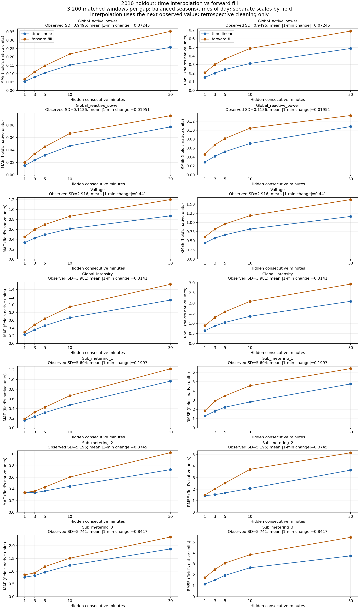

# Masking experiment: evidence and recommendation

**Recommendation:** five minutes is defensible only as a **provisional upper cap
for flagged retrospective cleaning**, not a blanket automatic rule for all seven
measurements. Interpolation beats forward fill on aggregate at five minutes, but
the error tails and subgroup results require field-specific acceptance tolerances.
Keep long gaps unfilled. For anomaly modeling and analyses that depend on peaks or
appliance switching, keep missing values flagged/excluded until sensitivity to
imputation has been assessed. No policy has been applied to `final.ipynb`.

## Reproduce locally

The experiment uses free local NumPy, Pandas, and Matplotlib, separately from the
standard-library audit dependencies. The pinned evaluation packages require
Python 3.11+; this run used Python 3.13.5:

```sh
python3 -m pip install -r requirements.txt
python3 -m unittest discover -s tests -v
MPLCONFIGDIR=/private/tmp/energy-review-mpl python3 scripts/evaluate_missing_data.py --input household_power_consumption.txt --output-dir reports/missing_data_evaluation --windows-per-stratum 200 --seed 20261117 --holdout-start 2010-01-01 --bootstrap 1000
```

`MPLCONFIGDIR` selects a writable temporary font cache on this Mac; on another
platform, select a writable directory there or omit it if the default is writable.
The script reads the raw file and verifies source/notebook hashes afterward. It
writes only the specified output directory. Re-running replaces the experiment
outputs, not the source or audit reports.

## Design

- Use 32-minute windows: 30 possible hidden minutes plus one endpoint on each
  side. Every original value in all seven measurements must be finite,
  nonnegative, and observed. Every internal timestamp step must be exactly one
  minute; invalid/off-minute timestamps, duplicate steps, absent timestamps, and
  real missing measurements break eligibility. No sorting, gap-filling, or
  interpolation is used to qualify a window.
- Select 200 nonoverlapping windows in each of 16 season/time-of-day strata,
  separately in the development period (before 2010) and the 2010 holdout. That
  gives **3,200 windows per partition, 6,400 total**. Seasons follow the notebook's
  month groups. Time groups are Night 00–05, Morning 06–11, Afternoon 12–17,
  Evening 18–23. Entire windows stay in the same stratum and partition.
- Seed `20261117` determines a random ordering of eligible starts; greedy
  selection rejects overlapping windows. This is balanced stratum sampling,
  not a prevalence-weighted estimate for the entire stream. Candidate counts in
  `sampling_counts.csv` are overlapping eligible starts, not independent windows.
- Each selected window is reused for gaps of **1, 3, 5, 10, and 30 minutes**.
  A separate scenario hides offsets 1 through the gap length in all seven
  measurements. Offset 0 and offset `gap + 1` remain observed. Scenarios are
  evaluated independently, so one simulated gap never fills another's endpoint.
- Both methods use exactly the same hidden truth. Forward fill uses offset 0;
  linear interpolation uses elapsed time between offsets 0 and `gap + 1`.
  On a verified regular-minute grid the time weights are `j / (gap + 1)`.
  Predictions do not access the hidden original values.
- **Interpolation uses a future observed endpoint. It supports retrospective
  cleaning, not a live forecasting claim.** Even forward-fill results here are
  a reconstruction experiment, not an evaluation of a forecasting model.

Each measurement/method has 3,200 masked readings for length 1, 9,600 for length
3, 16,000 for length 5, 32,000 for length 10, and 96,000 for length 30, **per
partition**. These scenarios share source windows across gap lengths; they are
not independent datasets.

MAE and RMSE are calculated over masked points only, separately by field and
gap length, with sample counts. No raw scores are averaged across fields.
`metrics_by_stratum.csv` retains each season/time group. Tail errors (95th/99th
absolute percentiles and maximum) and signed mean error are also exported.

## Actual five-minute holdout results

All raw errors below use each field's own native source units; rows cannot be
added or averaged into a raw combined score. Each row/method uses 3,200 windows
and 16,000 hidden measurements. The full results for **every gap length** and both
partitions are in [metrics.csv](../reports/missing_data_evaluation/metrics.csv).

| Measurement | Linear MAE | Linear RMSE | Forward-fill MAE | Forward-fill RMSE | Linear RMSE / observed SD |
| --- | ---: | ---: | ---: | ---: | ---: |
| Global_active_power | 0.10471 | 0.24303 | 0.14753 | 0.36621 | 25.60% |
| Global_reactive_power | 0.03154 | 0.05204 | 0.04517 | 0.08147 | 45.82% |
| Voltage | 0.49373 | 0.66309 | 0.69734 | 0.95987 | 22.74% |
| Global_intensity | 0.46235 | 1.04193 | 0.64245 | 1.56904 | 26.17% |
| Sub_metering_1 | 0.31649 | 2.23844 | 0.42562 | 3.46910 | 39.95% |
| Sub_metering_2 | 0.36554 | 1.68201 | 0.43175 | 2.53444 | 32.38% |
| Sub_metering_3 | 0.96116 | 1.95046 | 1.17956 | 3.07698 | 22.32% |

At five minutes, all seven holdout aggregate MAEs and RMSEs favor interpolation.
The development aggregate MAEs also favor interpolation for all seven fields.
For each field, the holdout 95% paired bootstrap interval for the difference in
MAE (linear minus forward fill) is below zero. These are exploratory intervals
from 1,000 resamples of windows within strata, not independent-point resamples.
Nearby windows can still be correlated; intervals do not capture missing-period
selection bias, and there is no multiple-comparison adjustment.

The aggregate advantage is not universal: **7 of 112** five-minute holdout
field/season/time combinations have higher MAE with interpolation. Five of
those are `Sub_metering_1` groups. This does not justify choosing a method per
group after inspecting the holdout; it motivates further validation.

## Compare with observed variability

`variability_reference.csv` reports per-field sample SD, IQR, and mean/median
absolute one-minute change over the **same full sampled 32-minute windows**,
separate by partition. Each holdout reference has 102,400 observed points and
99,200 within-window one-minute pairs. These are observed variability references,
not certified normal operating limits. Stratum metrics use the same partition-wide
field reference for comparability, not a separate within-stratum denominator.

Five-minute interpolation MAE is 11.03% of observed SD for active power, 16.93%
for voltage, and 27.77% for reactive power. Five-minute active-power MAE 0.10471
also exceeds its mean absolute one-minute change of 0.07245. The corresponding
voltage values are 0.49373 versus 0.44096. Error is therefore not negligible just
because it is smaller than overall signal SD.

Sparse/step-like sub-meter signals especially need tail checks. For
`Sub_metering_1`, holdout IQR and median absolute minute change are both zero,
while five-minute interpolation's 99th percentile absolute error is **12.0**
in that field's native units. SD normalization alone can obscure these changes.
The chart uses separate field scales and annotates observed SD and mean absolute
minute change:



An SVG version is available as `reports/missing_data_evaluation/comparison.svg`.

## What the evidence supports

Active-power interpolation RMSE rises from **0.15196** at one minute to
**0.20149** at three, **0.24303** at five, **0.31364** at ten, and **0.48736**
at thirty. Shorter gaps preserve detail better. Five minutes limits smoothing
compared with ten/thirty minutes, but there is no sharp five-minute breakpoint
and no externally supplied error tolerance that proves five minutes acceptable.

Use five minutes only as a provisional maximum for a separately flagged,
retrospective analysis layer with observed endpoints. Approve it per field/use
case against the reported raw and tail errors; use a shorter limit or leave the
gap unfilled where those errors matter. Do not automatically apply it to anomaly
detection or treat an interpolated record as observed evidence. Preserve original
values, missingness/treatment flags, and run IDs. Long gaps and boundary gaps
remain unfilled/excluded as described in the original policy proposal.

**Masking observed periods cannot prove how real missing periods behaved.**
Actual outages may coincide with extremes, switching, or sensor problems absent
from eligible windows. Requiring 32 complete minutes also conditions short-gap
tests on longer complete stretches. No experiment here establishes confirmed
faults, model accuracy, financial benefit, or time savings. This masking experiment
did not evaluate model-alert sensitivity or physical cross-field constraints.
The later [revised analysis](revised_analysis.md) compares observed-only modeling
with actual eligible short-gap imputation; it does not approve field-specific
error tolerances or validate physical constraints.

## Exported evidence

All outputs are under `reports/missing_data_evaluation/`:

| File | Purpose |
| --- | --- |
| `metrics.csv` | 140 field/gap/method/partition rows with errors, counts, normalized comparisons |
| `metrics_by_stratum.csv` | 2,240 corresponding season/time rows |
| `variability_reference.csv` | 14 per-field/partition observed variability references |
| `paired_method_comparison.csv` | 70 paired MAE differences and bootstrap intervals |
| `sampling_counts.csv` | 32 stratum eligibility/selection counts |
| `selected_windows.csv` | 6,400 selected windows with source row IDs and stratum |
| `sampled_truth.csv` | 204,800 preserved observed rows, seven fields and endpoints included |
| `mask_manifest.csv` | 32,000 reproducible masking scenarios and source bounds |
| `experiment_metadata.json` | Seed, split, source/notebook/script hashes and runtime versions |
| `comparison.png`, `comparison.svg` | Per-measurement MAE/RMSE comparison chart |
